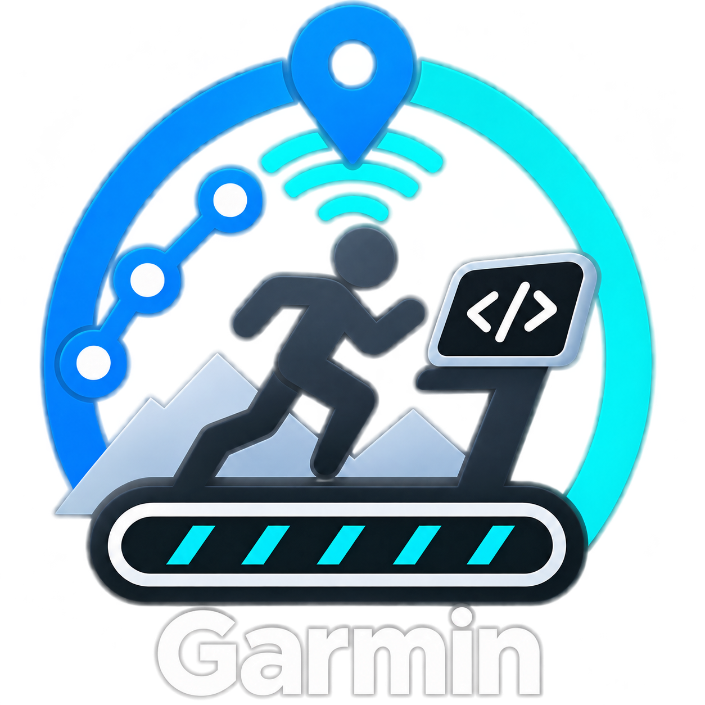

<a href="https://garmin.geekist.co/"></a>

# Garmin by geekist.co

[](https://glama.ai/mcp/connectors/io.github.theGeekist/garmin-mcp)

Ask your AI assistant about your Garmin Connect data. Review an activity and its laps, compare your running trends, or plan your next workout. Garmin by geekist.co is free to use.

[Connect your Garmin account](https://garmin.geekist.co/login) · [See what you can do](https://garmin.geekist.co/plans/)

## Connect your assistant

1. [Sign in to Garmin by geekist.co](https://garmin.geekist.co/login) and connect your Garmin account.
2. Add the remote Model Context Protocol (MCP) connection in your assistant, using its [setup guide](docs/clients/README.md). If prompted for a server URL, use:

   ```text
   https://garmin.geekist.co/mcp
   ```

3. Complete the sign-in and permission prompts, then try “Compare my runs over the last two complete weeks.”

You can also ask “How did my pace change across the laps of my last run?” or “Help me plan a 30-minute interval workout.” Saving a workout to Garmin requires separate permission and your explicit confirmation.

## Download a package

Choose a local package if you want the connection and the bundled [Garmin review skill](skills/garmin-review) in one install. Client features can vary by plan, version and workspace settings.

| Client | Package |
| --- | --- |
| Codex | [Local marketplace ZIP](dist/archives/garmin-mcp-0.3.6-codex-marketplace.zip) |
| Claude Code | [Local marketplace ZIP](dist/archives/garmin-mcp-0.3.6-claude-code.zip) |
| Claude | [Standalone plugin ZIP](dist/archives/garmin-mcp-0.3.6-claude-plugin.zip) |
| Gemini CLI | [Extension ZIP](dist/archives/garmin-mcp-0.3.6-gemini-cli.zip) |
| OpenAI plugin hosts | [Portable plugin ZIP](dist/archives/garmin-mcp-0.3.6-openai.zip) |

This repository contains client packages for Geekist’s hosted service. See the [package licence](LICENSE) and [SHA-256 checksums](dist/archives/SHA256SUMS).

## Help and privacy

[Get help](https://garmin.geekist.co/support/) · [Privacy policy](https://garmin.geekist.co/privacy/) · [Service terms](https://garmin.geekist.co/terms/)

Geekist operates Garmin by geekist.co independently of Garmin.

<a href="https://geekist.co/"></a>
