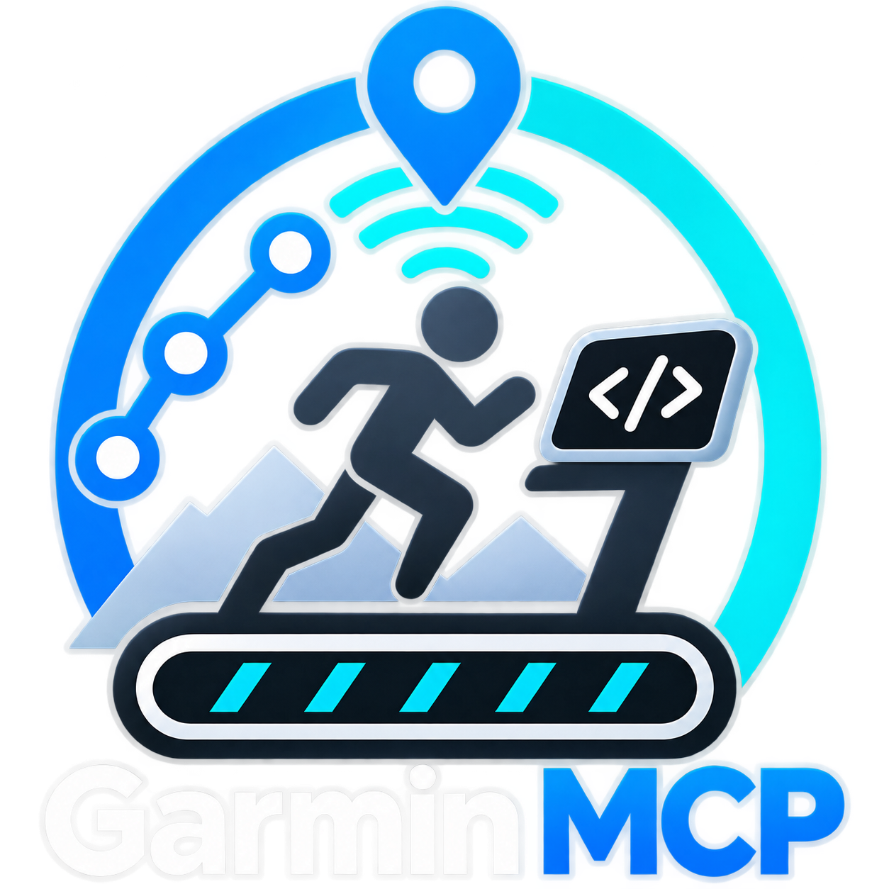

<a href="https://garmin.geekist.co/"></a>

# Garmin by geekist.co

[](https://glama.ai/mcp/connectors/io.github.theGeekist/garmin-mcp)

Ask your AI assistant about your Garmin Connect data. Review an activity and its laps, compare your running trends, or plan your next workout. Garmin by geekist.co is free to use.

[Connect your Garmin account](https://garmin.geekist.co/login) · [See what you can do](https://garmin.geekist.co/plans/)

## Connect your assistant

1. [Sign in to Garmin by geekist.co](https://garmin.geekist.co/login) and connect your Garmin account.
2. Add the remote Model Context Protocol (MCP) connection in your assistant, using its [setup guide](docs/clients/README.md). If prompted for a server URL, use:

   ```text
   https://garmin.geekist.co/mcp
   ```

3. Complete the sign-in and permission prompts, then try “Compare my runs over the last two complete weeks.”

You can also ask “How did my pace change across the laps of my last run?” or “Help me plan a 30-minute interval workout.” Saving a workout to Garmin requires separate permission and your explicit confirmation.

## Download a package

Choose a local package if you want the connection and the bundled [Garmin review skill](skills/garmin-review) in one install. Client features can vary by plan, version and workspace settings.

| Client | Package |
| --- | --- |
| Codex | [Local marketplace ZIP](dist/archives/garmin-mcp-0.3.12-codex-marketplace.zip) |
| Claude Code | [Local marketplace ZIP](dist/archives/garmin-mcp-0.3.12-claude-code.zip) |
| Claude | [Standalone plugin ZIP](dist/archives/garmin-mcp-0.3.12-claude-plugin.zip) |
| Gemini CLI | [Extension ZIP](dist/archives/garmin-mcp-0.3.12-gemini-cli.zip) |
| OpenAI plugin hosts | [Portable plugin ZIP](dist/archives/garmin-mcp-0.3.12-openai.zip) |

This repository contains client packages for Geekist’s hosted service. See the [package licence](LICENSE) and [SHA-256 checksums](dist/archives/SHA256SUMS).

## Help and privacy

[Get help](https://garmin.geekist.co/support/) · [Privacy policy](https://garmin.geekist.co/privacy/) · [Service terms](https://garmin.geekist.co/terms/)

Geekist operates Garmin by geekist.co independently of Garmin.

<a href="https://geekist.co/"></a>

## Build from a reviewed public baseline

The private service repository produces a seven-file public baseline: provider-neutral
metadata, OpenAI review metadata, the public skill and Gemini guidance. Review its
contents before making it public; an allowlist cannot identify every sensitive detail.
Do not copy the private checkout or its credentials into this repository.

To prepare a distribution locally, obtain the reviewed baseline and its SHA-256 through
an authorised handoff, then run:

```sh
python scripts/sync_public_baseline.py --baseline /path/to/baseline.zip --sha256 SHA256
python -m unittest discover -s tests -v
python scripts/distribution.py build --official-schemas --output-dir /tmp/garmin-packages
```

The importer checks the digest, exact members, public endpoint and owner-language guard,
then updates the catalogue, public skill, Gemini guidance, review metadata and versioned download links. Public branding and the package licence stay in this repository.
Review the resulting changes and rebuild committed `dist` before updating this repository.
The MCP registry manifest and publication are separate release operations.

The **Build from public baseline** workflow listens for new versioned ZIPs in `baselines/` and also supports a manual run with an immutable revision and digest. It downloads no private
source and uses no private-repository credential. It produces a short-lived workflow
artifact; it does not commit, publish a release, update the registry or submit a plugin.

## Versioned GitHub releases

A `vVERSION` tag triggers the distribution release workflow after it validates
committed packages and checks the tag against the catalogue. It attaches the
five provider ZIPs and `SHA256SUMS` together. Re-running succeeds only when all
six published assets have the expected SHA-256 digests; incomplete or different
releases require investigation and are never overwritten automatically.

MCP Registry publication is a separate workflow using `server.json`. The same
tag currently triggers it as well, and that workflow requires the registry
version to match the tag. Check registry readiness before creating a version tag.
